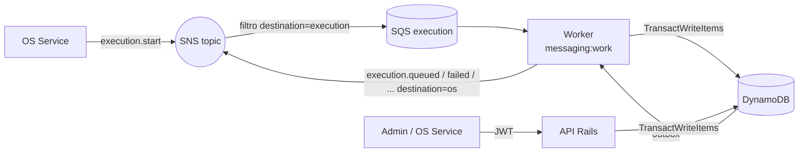

# Execution Service (Execução e Produção)

Microsserviço da fase 4 do sistema de oficina mecânica (FIAP SOAT). Controla a **fila de execução** das ordens de serviço
(diagnóstico, reparo e finalização) e é dono do **catálogo de peças e do estoque**. Participa da saga orquestrada pelo
OS Service: reserva o estoque quando o pagamento é aprovado e, se não houver peças, devolve uma falha que dispara a compensação
(estorno do pagamento).

## Responsabilidades

- Consumir o comando `execution.start`, reservar o estoque das peças de forma atômica e enfileirar a execução.
- Publicar `execution.queued` ou `execution.failed` (`insufficient_stock` / `unknown_part`).
- Controlar as transições `queued → in_diagnosis → in_repair → finished` (endpoints de admin) e publicar um evento a cada uma.
- CRUD de peças e movimentações de estoque (entrada, saída, ajustes).
- Responder de forma síncrona a `GET /api/v1/parts/:id` (consultado pelo OS Service ao abrir uma OS com peças).

## Tecnologias

Ruby 3.4.3, Rails 8.1 (API), **DynamoDB** (`aws-sdk-dynamodb`), SNS/SQS (`aws-sdk-sns`, `aws-sdk-sqs`), JWT HS256, rswag (Swagger),
lograge (logs JSON), Datadog (`datadog`, `dogstatsd-ruby`), RSpec + SimpleCov, Brakeman, bundler-audit, RuboCop (omakase).
Localmente o DynamoDB, SNS e SQS rodam no LocalStack 4.4.

## Arquitetura



Estrutura (Clean Architecture por contexto):

```
app/domains/execution/   use_cases (StartExecution, TransitionExecution), queries, gateways, statuses
app/domains/inventory/   use_cases (CreatePart, UpdatePart, DeactivatePart, RegisterMovement), gateways
app/controllers/api/v1/  controllers finos (parts, stock_movements, executions)
app/lib/dynamo*          schema único das tabelas, provisionador, outbox
app/lib/messaging*       envelope, bus SNS, consumer SQS, worker, idempotência em DynamoDB
```

Garantias: entrega at-least-once, consumidor idempotente (`processed-messages`) e publicação **sempre via outbox**, gravada na mesma
transação da mudança de estado.

## Mensagens

Consumidas (fila `auto-repair-<env>-execution`):

| type | payload |
|---|---|
| `execution.start` | `vehicle`, `services [{name, quantity}]`, `parts [{part_id, name, quantity}]`, `notes` |

Publicadas (`destination=os`):

| type | payload |
|---|---|
| `execution.queued` | `position` |
| `execution.failed` | `reason` (`insufficient_stock` \| `unknown_part`), `details [{part_id, name, requested, available}]` |
| `execution.diagnosis_started` | `notes` |
| `execution.repair_started` | `notes` |
| `execution.finished` | `notes`, `finished_at` |

O envelope segue `contracts.md` (message_id, type, kind, source, destination, saga_id, correlation_id, service_order_uuid, trace, payload).

## Endpoints

Todos exigem `Authorization: Bearer <JWT admin>` (`aud=admin`, `iss=auto-repair-api`), exceto `/up`. Swagger em `/api-docs`.

| Método | Rota | Descrição |
|---|---|---|
| GET | `/up` | health check |
| GET | `/api/v1/executions?status=` | fila: `in_repair > in_diagnosis > queued`, mais antigas primeiro |
| GET | `/api/v1/executions/:service_order_uuid` | detalhe e timeline |
| POST | `/api/v1/executions/:service_order_uuid/start_diagnosis` | `queued → in_diagnosis` (`{notes}` opcional) |
| POST | `/api/v1/executions/:service_order_uuid/start_repair` | `in_diagnosis → in_repair` |
| POST | `/api/v1/executions/:service_order_uuid/finish` | `in_repair → finished` |
| GET/POST | `/api/v1/parts` | lista / cria peça (`stock_quantity` inicial gera movimentação `inbound`) |
| GET/PATCH/DELETE | `/api/v1/parts/:id` | detalhe / atualiza / desativa (soft delete, `active=false`) |
| GET/POST | `/api/v1/parts/:id/stock_movements` | histórico / registra `inbound`, `outbound`, `adjustment_in`, `adjustment_out` |

Transição inválida retorna `422` com o código `invalid_transition` e a próxima ação válida; execução inexistente retorna `404`.
Saída que deixaria o estoque negativo retorna `422`. Erros seguem `{ "error": { "code", "message", "details" } }`.

## Modelo de dados no DynamoDB

Prefixo das tabelas: `DYNAMODB_TABLE_PREFIX` (padrão `auto-repair-local-execution`). Cobrança `PAY_PER_REQUEST`.
A definição vive em um único lugar, `app/lib/dynamo/schema.rb`, e é espelhada no Terraform.

| Tabela | Chave | Índices | Atributos principais |
|---|---|---|---|
| `<prefix>-parts` | PK `part_id` (S) | - | sku, name, description, unit_price_cents, stock_quantity, active, created_at, updated_at |
| `<prefix>-stock-movements` | PK `part_id` (S), SK `movement_key` (S = `iso8601#uuid`) | - | movement_type (`inbound`, `outbound`, `adjustment_in`, `adjustment_out`, `reservation`, `release`), quantity, reason, reference |
| `<prefix>-executions` | PK `service_order_uuid` (S) | GSI `status-queued_at-index` (PK `status`, SK `queued_at`) | saga_id, status, vehicle (M), services (L), parts (L), notes, diagnosis_notes, timeline (L), queued_at, started_at, finished_at |
| `<prefix>-outbox` | PK `message_id` (S) | - | body (JSON do envelope), created_at |
| `<prefix>-processed-messages` | PK `message_id` (S) | TTL `expires_at` (7 dias) | created_at |

### Padrões de acesso

| Padrão | Operação |
|---|---|
| Peça por id (OS Service consulta ao abrir OS) | `GetItem` em parts |
| Listar catálogo | `Scan` em parts (catálogo pequeno; ordenação e filtros em memória) |
| Histórico de uma peça, mais recente primeiro | `Query` em stock-movements por `part_id`, `ScanIndexForward=false` |
| Execução por OS | `GetItem` em executions |
| Fila de execução | `Query` no GSI por `status` (um por status), ordenado por `queued_at`; os resultados são concatenados na ordem de prioridade |
| Posição na fila | `Query` com `Select=COUNT` no GSI para `queued` |
| Reservar estoque + enfileirar | `TransactWriteItems`: `Update` condicional por peça, `Put` de movimentações, `Put` condicional da execução, `Put` do outbox |
| Transição de status | `TransactWriteItems`: `Update` condicionado ao status atual + `Put` do outbox |
| Entrada/saída manual | `TransactWriteItems`: `Update` (condição `stock_quantity >= :q` nas saídas) + `Put` da movimentação |
| Publicar eventos | `Scan` do outbox, publica por `created_at`, `DeleteItem` após publicar |
| Deduplicar mensagens | `PutItem` condicional (`attribute_not_exists`) em processed-messages |

### Por que NoSQL aqui

- Os acessos são conhecidos e por chave (peça, OS, status). Não há joins nem consultas ad hoc; o GSI cobre a única consulta "por fila".
- A atomicidade necessária (reservar várias peças, criar a execução e gravar o evento) cabe em uma `TransactWriteItems`, e as condições
  (`stock_quantity >= :q`, `attribute_not_exists`, status atual) tornam as regras de negócio atômicas sem locks nem `SELECT FOR UPDATE`.
- `timeline`, `vehicle`, `services` e `parts` são documentos que sempre são lidos junto da execução: o modelo de itens com atributos
  aninhados evita tabelas filhas.
- Escala horizontal e cobrança por uso (on-demand) combinam com uma fila de trabalho de carga variável; TTL limpa a tabela de idempotência sem job.
- Limitações assumidas: uma transação aceita até 100 itens (cerca de 49 peças distintas por OS) e a posição na fila é calculada na leitura
  (pode divergir em enfileiramentos simultâneos, é informativa).

## Como rodar localmente

Requer apenas Docker.

```bash
docker compose -p execution up -d --build        # api (3002), worker e localstack
docker compose -p execution exec api bin/rails dynamo:seed   # peças de demonstração (idempotente)
curl localhost:3002/up
```

Peças do seed: `oleo-5w30` (50), `filtro-oleo` (30), `pastilha-freio` (10) e `kit-embreagem` (**0**, usada para demonstrar a compensação da saga).

Token de admin para testar:

```bash
docker compose -p execution exec api bin/rails runner 'puts Identity::Services::JwtEncoder.encode({"sub" => "1"})'
curl -H "Authorization: Bearer <token>" localhost:3002/api/v1/parts
```

Derrubar tudo: `docker compose -p execution down -v`.

Os containers `api` e `worker` criam as tabelas e a infraestrutura de mensageria no boot (`DYNAMODB_AUTO_PROVISION` e
`MESSAGING_AUTO_PROVISION`). Na AWS elas vêm do Terraform. O comando `bin/rails dynamo:setup` cria as tabelas manualmente.

## Testes e qualidade

Os testes rodam contra o DynamoDB do LocalStack (tabelas criadas uma vez por execução e limpas a cada teste):

```bash
docker compose -p execution up -d localstack
docker compose -p execution run --rm -e RAILS_ENV=test -e DYNAMODB_TABLE_PREFIX=auto-repair-test-execution api bundle exec rspec
docker compose -p execution run --rm api bin/rubocop
docker compose -p execution run --rm api bin/brakeman --quiet --no-pager
docker compose -p execution run --rm api bin/bundler-audit
docker compose -p execution run --rm -e RAILS_ENV=test -e DYNAMODB_TABLE_PREFIX=auto-repair-test-execution api bundle exec rake rswag:specs:swaggerize
```

A cobertura mínima de 80% é imposta pelo SimpleCov.

## Variáveis de ambiente

| Variável | Descrição | Padrão |
|---|---|---|
| `JWT_SECRET` | segredo HS256 compartilhado com os outros serviços | obrigatória |
| `SERVICE_NAME` / `DD_SERVICE` | nome do serviço em logs, métricas e traces | `execution-service` |
| `DYNAMODB_TABLE_PREFIX` | prefixo das tabelas | `auto-repair-local-execution` |
| `DYNAMODB_AUTO_PROVISION` | `true` cria as tabelas no boot (só local) | - |
| `AWS_REGION` | região | `us-east-1` |
| `AWS_ENDPOINT_URL` | endpoint do LocalStack (só local) | - |
| `AWS_ACCESS_KEY_ID` / `AWS_SECRET_ACCESS_KEY` | credenciais (`test` local; no EKS via Pod Identity) | - |
| `EVENTS_TOPIC_ARN` | tópico SNS de eventos | obrigatória no worker (exceto auto provision) |
| `QUEUE_URL` | fila SQS do serviço | obrigatória no worker (exceto auto provision) |
| `MESSAGING_AUTO_PROVISION` | `true` cria tópico, fila, DLQ e assinatura (só local) | - |
| `EVENTS_TOPIC_NAME` / `QUEUE_NAME` | nomes usados no auto provision | `auto-repair-local-events` / `auto-repair-local-execution` |
| `DD_AGENT_HOST`, `DD_ENV`, `DD_VERSION` | Datadog (traces e métricas) | desligado se ausente |

## Observabilidade

Logs JSON (lograge e logger do worker) com `service`, `saga_id`, `correlation_id`, `message_id`, `service_order_uuid` e `dd.trace_id`.
Métricas (namespace `auto_repair`): `execution.stock_reservation` (tag `result`), `execution.status_changed` (tags `from`, `to`),
`execution.duration` (distribuição, em segundos, por status), além de `messaging.published|consumed|failed`.

## CI/CD

Pipeline em [.github/workflows/ci.yml](.github/workflows/ci.yml) (GitHub Actions), independente dos outros serviços:

| Job | Quando | O que faz |
|---|---|---|
| `security` | push e PR | RuboCop, Brakeman e bundler-audit |
| `test` | push e PR | RSpec + Cucumber (BDD) com cobertura; publica `coverage/` e `tmp/cucumber.html` como artefato `test-reports` |
| `quality` | push e PR | análise no SonarQube Cloud (`IgorSantosXP_auto-repair-execution-service`) e espera o Quality Gate |
| `manifests` | push e PR | `kustomize build` dos overlays e `terraform fmt/validate` |
| `deploy` | push em `main` (prod) e `homolog`, só com a variável `DEPLOY_ENABLED=true` (ou *Run workflow*) | `terraform apply` (fila, IAM, tabelas DynamoDB), build e push da imagem no ECR, secrets, `kubectl apply` do overlay, rollout da API e do worker e smoke test via API Gateway (espera 401 em /api/v1/parts) |

A `main` é protegida: só recebe código por Pull Request com os checks `security`, `test`, `quality` e `manifests` verdes.
A autenticação na AWS usa OIDC (role `auto-repair-github-actions`), sem chaves estáticas.

Secrets do repositório: `SONAR_TOKEN`.

### Infraestrutura própria (Terraform)

[terraform/](terraform/) provisiona apenas o que pertence a este serviço (state em `services/execution/terraform.tfstate`),
lendo do state do `auto-repair-infra-k8s` o cluster, a VPC e o tópico SNS:

- fila SQS `auto-repair-<env>-execution` + DLQ (3 tentativas) assinada no tópico com filtro `destination = execution`;
- role IAM `auto-repair-execution-service` associada ao ServiceAccount via EKS Pod Identity (publicar no SNS, consumir a fila, acessar as próprias tabelas);
- tabelas DynamoDB `auto-repair-<env>-execution-*` (on-demand), espelhando [app/lib/dynamo/schema.rb](app/lib/dynamo/schema.rb).

```bash
cd terraform && make init && make plan && make up   # make down destrói
```

## Kubernetes

Manifestos com Kustomize em [k8s/](k8s/): `base` (Deployment `api`, Deployment `worker`, Service, HPA 1–4 réplicas por CPU,
ServiceAccount e Job `dynamo-seed`) e overlays `prod` e `homolog`, cada um em seu namespace
(`auto-repair-execution-prod` / `auto-repair-execution-homolog`). Em prod o Service é exposto também como NodePort `30082`,
alvo do NLB que o API Gateway usa.

```bash
kubectl apply -k k8s/overlays/prod
kubectl -n auto-repair-execution-prod get pods,hpa
```

## Cobertura

Última execução local: **94,44%** de cobertura de linhas (suíte RSpec), mínimo de 80% imposto pelo SimpleCov,
e **3 cenários Cucumber** em [features/execucao_da_os.feature](features/execucao_da_os.feature). Na pipeline, o relatório HTML fica no artefato `test-reports` de cada execução
e a cobertura é enviada ao SonarQube Cloud.
